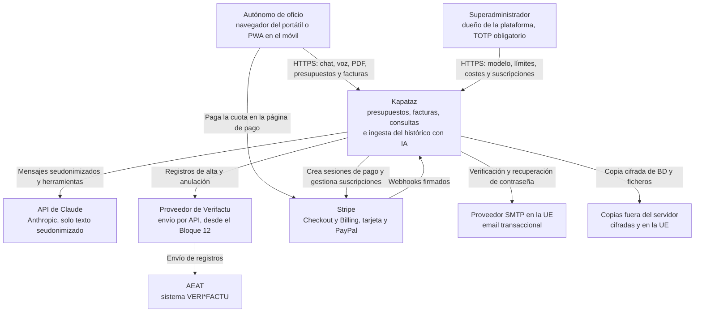
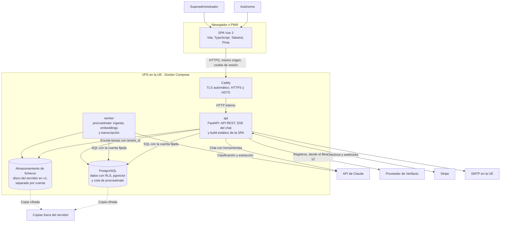
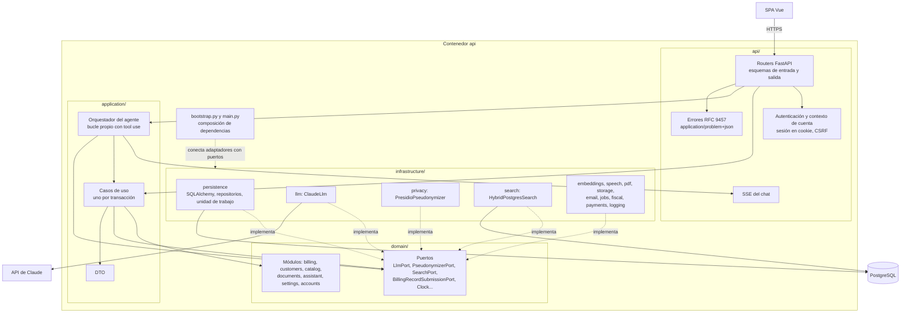
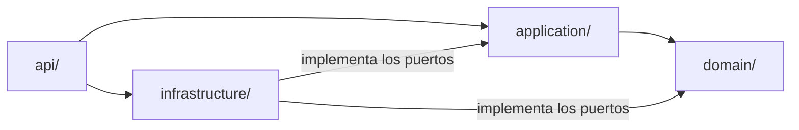
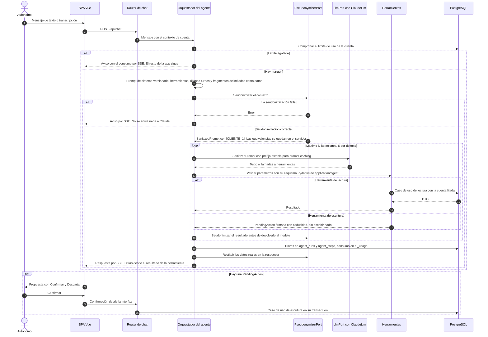
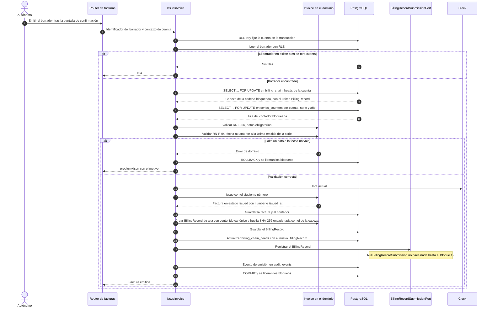

# Kapataz — Arquitectura

## 1. Introducción

Este documento describe cómo se construye Kapataz: contexto, contenedores, componentes, capas, puertos, modelo de datos y los dos flujos críticos (agente y emisión de factura). Cierra con la Definición de Terminado que aplica a todos los bloques.

- Qué hace el sistema y con qué reglas: [`01-especificacion.md`](./01-especificacion.md).
- Por qué se decidió cada cosa: los ADR de [`adr/`](./adr/), citados aquí como «ADR-NNN».
- Plan de construcción por bloques: [`00-plan-maestro.md`](./00-plan-maestro.md).
- Amenazas y controles: [`03-modelo-amenazas.md`](./03-modelo-amenazas.md).

Si este documento contradice la especificación o un ADR, mandan ellos. Se corrige este documento.

> **Aviso legal.** Las facturas son válidas y legales y el sistema es VERI\*FACTU. Aun así, ningún cliente real emite facturas hasta cerrar el Bloque 12, con la declaración responsable firmada y la validación de un asesor fiscal. Hasta publicar la 1.0.0 el registro está cerrado (RN-13) y las cuentas existentes solo trabajan en el espacio de demostración (RN-F-09).

Los diagramas usan Mermaid. Los de C4 se dibujan como `flowchart` para que se vean en GitHub sin extensiones.

---

## 2. C4

### 2.1 Nivel 1 — Contexto



Fronteras que importan:

- A Claude solo llega texto seudonimizado. Nunca un PDF, una imagen ni un audio (RN-11, ADR-030, ADR-029).
- Los datos de tarjeta no pasan por Kapataz: el pago se hace en la página de Stripe (ADR-016).
- El envío a la AEAT va por el proveedor detrás de `BillingRecordSubmissionPort`. Hasta el Bloque 12 el adaptador es nulo y no sale nada (ADR-012).

### 2.2 Nivel 2 — Contenedores



| Contenedor | Responsabilidad | ADR |
|---|---|---|
| Caddy | Única entrada desde internet. TLS automático. La BD y los servicios internos no se exponen (RNF-12). | ADR-014 |
| api | FastAPI. Sirve la API, el SSE del chat y el build de Vue en el mismo origen: sin CORS y con cookies sencillas. Ejecuta el agente. | ADR-002, ADR-013 |
| worker | Proceso aparte con procrastinate. Ingesta, embeddings y transcripción. Cada tarea lleva su `tenant_id`. Concurrencia limitada para Whisper. | ADR-026, ADR-011 |
| PostgreSQL | Datos de negocio con RLS, búsqueda de texto, pgvector y la cola de tareas. Sin Redis. | ADR-004, ADR-007, ADR-024 |
| Almacenamiento de ficheros | PDFs separados por cuenta, detrás de `FileStoragePort`. Disco del servidor en v1; S3 compatible en la UE después. | — |

### 2.3 Nivel 3 — Componentes del contenedor api



| Componente | Qué hace |
|---|---|
| Routers | Reciben la petición, validan el esquema y llaman a un caso de uso o al orquestador. Sin reglas de negocio. No exponen entidades del dominio. |
| Autenticación y contexto de cuenta | Resuelve la sesión de la cookie y entrega al caso de uso la cuenta y el usuario. |
| Casos de uso | Uno por fichero y una transacción por caso de uso. Las herramientas de lectura del agente son casos de uso que devuelven DTO. |
| Orquestador del agente | Construye el contexto, seudonimiza, llama a `LlmPort`, ejecuta herramientas, crea `PendingAction` y emite por SSE (§6). |
| Dominio | Entidades, objetos de valor, reglas RN y RN-F, y puertos. Python puro. |
| Adaptadores | Implementan los puertos. `bootstrap.py` los conecta. |

---

## 3. Capas y reglas de dependencia

Arquitectura hexagonal ligera en cuatro capas (ADR-001).



| Capa | Contiene | Puede importar | No puede importar |
|---|---|---|---|
| `domain/` | Entidades, objetos de valor, reglas RN, puertos | Biblioteca estándar | `application`, `infrastructure`, `api`, FastAPI, SQLAlchemy, SDK `anthropic`, librerías de E/S |
| `application/` | Casos de uso, orquestador del agente, DTO | `domain` | `infrastructure`, `api` |
| `infrastructure/` | PostgreSQL y SQLAlchemy, Claude, seudonimización, embeddings, Whisper, pdfplumber, Tesseract, ReportLab, ficheros, email, pagos, cola de tareas, Verifactu | `domain`, `application` (puertos) | `api` |
| `api/` | Routers, autenticación y contexto de cuenta, esquemas, errores RFC 9457, SSE | `application`, `infrastructure` | — |

Reglas fijas:

- El dominio no lee la hora del sistema. El tiempo entra por el puerto `Clock`; nunca `datetime.now()`.
- Un caso de uso es una transacción.
- El dinero es `Decimal` en el dominio y céntimos enteros en BD. El LLM nunca calcula importes (RN-01, RN-02, ADR-009).
- `bootstrap.py` y `main.py` son la raíz de composición: quedan fuera del contrato y conectan cada adaptador con su puerto.

### Contrato de import-linter

import-linter hace cumplir estas fronteras en CI. La configuración real llega en el Bloque 1; este es su contenido:

1. **Contrato de capas** (`layers`), de arriba abajo: `kapataz.api`, `kapataz.infrastructure`, `kapataz.application`, `kapataz.domain`. Una capa solo importa las que tiene debajo. Así `application` solo ve `domain`, y `domain` no ve a nadie.
2. **Contrato de prohibición** (`forbidden`) sobre `kapataz.domain` y `kapataz.application`: no importan FastAPI, SQLAlchemy, `anthropic` ni las librerías de los adaptadores. Requiere analizar paquetes externos.

Si una importación rompe el contrato, CI falla. La solución nunca es relajar el contrato sin ADR.

---

## 4. Módulos del dominio, puertos y adaptadores

### 4.1 Módulos del dominio

Cada módulo es una carpeta en `src/kapataz/domain/`. Los nombres siguen el glosario de la especificación.

| Módulo | Responsabilidad |
|---|---|
| `billing` | `Quote`, `Invoice`, `CorrectiveInvoice`, `LineItem`, `Money`, `TaxRate`, `Series`, numeración, emisión, `BillingRecord` |
| `customers` | `Customer`, deduplicación, `TaxId` (validación de NIF, NIE y CIF) |
| `catalog` | `CatalogItem`, precios de referencia |
| `documents` | `SourceDocument`, `Extraction`, estados de revisión |
| `assistant` | Catálogo de herramientas (nombre y si son de lectura o de escritura), políticas de confirmación, transcripción. Los esquemas Pydantic que validan los parámetros de cada herramienta viven en `application/agent`, porque el dominio es Python puro |
| `settings` | Perfil del profesional, perfil fiscal |
| `accounts` | `Tenant`, `User`, `PlatformAdmin`, `Subscription`, sesiones, límites de consumo de IA |

Las reglas RN-01 a RN-06 y RN-F-01 a RN-F-13 viven en el dominio, no en la API.

### 4.2 Puertos y adaptadores

Los puertos se definen en `domain/` y `application/`. Cada uno tiene un adaptador real y, si lo indica la tabla, uno falso para pruebas. CI usa siempre el LLM falso determinista (ADR-008).

| Puerto | Adaptador v1 | Adaptador futuro | Carpeta en `infrastructure/` |
|---|---|---|---|
| `LlmPort` (chat con herramientas y salida estructurada; solo acepta `SanitizedPrompt`) | `ClaudeLlm`, `FakeLlm` | Otro proveedor | `llm` |
| `PseudonymizerPort` | `PresidioPseudonymizer`, `FakePseudonymizer` | | `privacy` |
| `EmbeddingPort` | `LocalEmbeddings` (fastembed), `FakeEmbeddings` | | `embeddings` |
| `TranscriptionPort` | `FasterWhisper`, `FakeTranscription` | | `speech` |
| `PdfTextPort` | `PdfPlumberReader`, `FakePdfText` | | `pdf` |
| `OcrPort` | `TesseractOcr`, `FakeOcr` | Fotos de tiques | `pdf` |
| `PdfRenderPort` | `ReportLabRenderer`, `FakePdfRender` | | `pdf` |
| `SearchPort` | `HybridPostgresSearch` (texto, pgvector y RRF) | | `search` |
| `BillingRecordSubmissionPort` | `NullBillingRecordSubmission` hasta el Bloque 12; después `VerifactuProviderSubmission` | `VerifactuAeatSubmission` (envío directo como colaborador social) | `fiscal` |
| `SubscriptionPort` | `StripeSubscriptions`, `FakeSubscriptions` | Otra pasarela | `payments` |
| `FileStoragePort` | `LocalFileStorage` | Almacenamiento S3 compatible en la UE | `storage` |
| `EmailPort` | `SmtpEmail`, `FakeEmail` | | `email` |
| `Clock` | `SystemClock`, `FrozenClock` | | — |

Además de los puertos, `infrastructure/` tiene `persistence` (repositorios SQLAlchemy y unidad de trabajo), `jobs` (cola de procrastinate) y `logging` (structlog JSON, ADR-015).

Puntos de diseño:

- `LlmPort` solo acepta `SanitizedPrompt`. Un texto sin seudonimizar no compila contra el puerto, y si la seudonimización falla no se envía nada (ADR-030).
- `BillingRecordSubmissionPort` existe desde el Bloque 2. La emisión ya lo llama; el adaptador nulo no hace nada hasta el Bloque 12 (ADR-012).
- Cambiar de proveedor de IA, de pasarela o de envío a la AEAT es cambiar un adaptador, no el dominio.

---

## 5. Modelo de datos

El modelo completo está en §4.5 del plan maestro. Aquí van las tablas, sus relaciones principales, las claves, `tenant_id` y las columnas que usan las reglas. Los tipos del diagrama son descriptivos (`id`, `fk`, `enum`, `cents`…); los tipos físicos los fijan las migraciones del Bloque 2.

### 5.1 Cuentas y plataforma

```mermaid
erDiagram
    tenants ||--o{ users : "tiene"
    users ||--o{ sessions : "abre"
    tenants ||--o{ subscriptions : "paga"
    tenants ||--o{ payment_events : "recibe"
    tenants ||--|| professional : "datos fiscales"
    tenants ||--o{ ai_usage : "consume"
    tenants ||--o{ audit_events : "registra"
    tenants |o--o{ tenants : "espacio de demostración"
    platform_admins ||--o{ platform_audit_events : "registra"

    tenants {
        id id PK
        enum kind "standard, demo"
        fk parent_tenant_id FK "solo en demo"
    }
    users {
        id id PK
        fk tenant_id FK
    }
    sessions {
        id id PK
        fk user_id FK
    }
    subscriptions {
        id id PK
        fk tenant_id FK
    }
    payment_events {
        id id PK
        fk tenant_id FK
    }
    platform_settings {
        bool registration_open "RN-13"
    }
    platform_admins {
        id id PK
    }
    platform_audit_events {
        id id PK
    }
    professional {
        id id PK
        fk tenant_id FK "una fila por cuenta"
    }
    ai_usage {
        id id PK
        fk tenant_id FK
    }
    audit_events {
        id id PK
        fk tenant_id FK
    }
```

- `tenants.kind` distingue la cuenta normal (`standard`) del espacio de demostración (`demo`), que guarda en `parent_tenant_id` la cuenta a la que pertenece (RF-CF-04, RN-13). Las facturas de un espacio `demo` llevan la marca de RN-F-09.
- `platform_settings` guarda el modelo y el `effort` por ruta, los límites, el tope global, los plazos de gracia y de solo lectura y `registration_open`. Solo escribe el superadministrador.
- `platform_admins` guarda los superadministradores: se crean fuera del registro, con TOTP obligatorio (RF-SA-01, ADR-031).
- `platform_audit_events` guarda cada cambio hecho en la zona de superadministración, con fecha, autor y valores anterior y nuevo (RF-SA-06).
- `payment_events` no repite ningún evento de la pasarela.
- `ai_usage` guarda tokens y coste por petición y por cuenta (ADR-028).
- `audit_events` guarda emisión, rectificación, cobro y confirmaciones del agente (RF-FA-08).

### 5.2 Facturación

```mermaid
erDiagram
    customers ||--o{ quotes : "recibe"
    quotes ||--|{ quote_versions : "versiona"
    quote_versions ||--|{ quote_lines : "contiene"
    customers ||--o{ invoices : "recibe"
    quote_versions |o--o{ invoices : "se factura en"
    invoices ||--|{ invoice_lines : "contiene"
    invoices ||--o{ invoice_corrections : "rectifica"
    invoices ||--o{ invoice_corrections : "es rectificada"
    invoices ||--o{ billing_records : "genera"
    billing_records |o--o| billing_records : "encadena con el anterior"
    billing_chain_heads |o--o| billing_records : "apunta al último"
    invoices ||--o{ payments : "se cobra con"

    customers {
        id id PK
        fk tenant_id FK
        text tax_id "único por cuenta cuando existe"
        enum tax_id_type
        text tax_id_country
    }
    catalog_items {
        id id PK
        fk tenant_id FK
    }
    quotes {
        id id PK
        fk tenant_id FK
        fk customer_id FK
    }
    quote_versions {
        id id PK
        fk tenant_id FK
        fk quote_id FK
        enum recipient_type "private, community, business"
        bool dwelling_over_two_years "RN-F-13"
    }
    quote_lines {
        id id PK
        fk tenant_id FK
        fk quote_version_id FK
        bool is_material "límite del 40 por ciento"
        bool outside_works "segunda factura al 21"
    }
    invoices {
        id id PK
        fk tenant_id FK
        fk customer_id FK
        fk quote_version_id FK "opcional"
        enum status "draft, issued"
        text series
        int number "se asigna al emitir"
        timestamptz issued_at
        enum phase_type "full, advance, progress, final"
        enum invoice_type "F1, R1 a R4"
        enum correction_type "substitution, difference"
        enum recipient_type "si no sale de un presupuesto"
        bool dwelling_over_two_years
        cents tax_total
        cents total_amount "base más cuota"
        cents amount_due "importe a cobrar"
        date due_date
    }
    invoice_lines {
        id id PK
        fk tenant_id FK
        fk invoice_id FK
        enum origin "quote, additional, prior_invoice"
        bool is_material
        bool outside_works
    }
    invoice_corrections {
        fk tenant_id FK
        fk corrective_invoice_id FK
        fk rectified_invoice_id FK
        cents rectified_base "solo por sustitución"
        cents rectified_tax "solo por sustitución"
    }
    series_counters {
        fk tenant_id PK
        text series PK
        int year PK
    }
    billing_chain_heads {
        fk tenant_id PK "una fila por cuenta"
    }
    billing_records {
        id id PK
        fk tenant_id FK
        fk invoice_id FK
        enum record_type "registration, cancellation"
        bool is_correction "subsanación"
        bool is_first
        text prev_hash
        text hash "SHA-256"
        timestamptz generated_at
        enum submission_status "pending, accepted, accepted_with_errors, rejected"
        text external_ref
    }
    payments {
        id id PK
        fk tenant_id FK
        fk invoice_id FK
        date paid_at
        enum method "cash, card, transfer, bizum, cheque, deposit"
    }
    submission_authorizations {
        id id PK
        fk tenant_id FK "Bloque 12"
    }
```

- `invoices` tiene un trigger que impide `UPDATE` y `DELETE` de los campos fiscales con `status='issued'` (RN-F-02).
- `series_counters` es un contador por cuenta, serie y año. Se bloquea con `SELECT … FOR UPDATE` en la misma transacción que la emisión (RN-F-01).
- `billing_chain_heads` tiene una fila por cuenta con el último registro de la cadena. Toda operación que añade un registro la bloquea con `SELECT … FOR UPDATE` antes que el contador de la serie, siempre en ese orden y en la misma transacción (RN-F-07). Así, dos emisiones simultáneas no enlazan con el mismo registro anterior aunque sean de series distintas (F y R).
- `billing_records` forma una sola cadena por cuenta con altas, subsanaciones y anulaciones. Una factura puede tener varios registros. La anulación se deduce de la cadena, sin tocar la factura (RN-F-07). El contenido canónico JSON usa los campos de `RegistroAlta` y `RegistroAnulacion` desde el Bloque 2. El encadenamiento guarda también `prev_issuer_tax_id`, `prev_series_number` y `prev_issue_date`, y el sistema que lo generó (`system_name`, `system_id`, `system_version`, `installation_number`).
- `invoices` guarda además la garantía (`guarantee_pct`, `guarantee_amount`, `guarantee_due_date`), separada de la retención de IRPF, y los datos del registro de la AEAT: `operation_date`, `description`, `regime_key`, `operation_class` y `exemption_cause`.
- `invoices.status` es el estado fiscal. El estado de cobro sale de `payments` (RF-FA-06, RN-F-10).
- `submission_authorizations` guarda la autorización de cada cuenta para enviar sus registros (RF-VF-07): a favor de quién, tipo de firma, documento firmado guardado con `FileStoragePort`, fecha de firma, revocación y fecha hasta la que se conserva bloqueada (RN-12). Se crea en el Bloque 12.

### 5.3 Documentos, búsqueda y agente

```mermaid
erDiagram
    source_documents ||--o{ extractions : "se extrae en"
    extractions ||--|{ extraction_fields : "contiene"
    source_documents ||--o| historical_invoices : "aprobado como"
    historical_invoices ||--|{ historical_lines : "contiene"
    source_documents ||--o{ chunks : "se trocea en"
    agent_runs ||--|{ agent_steps : "contiene"

    source_documents {
        id id PK
        fk tenant_id FK
    }
    extractions {
        id id PK
        fk tenant_id FK
        fk source_document_id FK
    }
    extraction_fields {
        id id PK
        fk tenant_id FK
        fk extraction_id FK
    }
    historical_invoices {
        id id PK
        fk tenant_id FK
        fk source_document_id FK
    }
    historical_lines {
        id id PK
        fk tenant_id FK
        fk historical_invoice_id FK
    }
    chunks {
        id id PK
        fk tenant_id FK
        fk source_document_id FK
    }
    agent_runs {
        id id PK
        fk tenant_id FK
    }
    agent_steps {
        id id PK
        fk tenant_id FK
        fk agent_run_id FK
    }
```

- `source_documents` guarda el hash del fichero (deduplicación por cuenta, RF-IN-07) y el estado de revisión. `extraction_fields` guarda la confianza por campo.
- `historical_invoices` y `historical_lines` son el histórico importado y revisado. Están separados de `invoices` y no se mezclan con la serie emitida (RN-F-08, ADR-017).
- `chunks` tiene una columna `tsvector` y otra `vector` (pgvector) para la búsqueda híbrida (ADR-007).
- `agent_runs` y `agent_steps` guardan herramienta, parámetros y duración, sin contenido de documentos.

### 5.4 RLS, rol de aplicación e inmutabilidad

- Toda tabla de negocio lleva `tenant_id` y una política RLS (ADR-024).
- La aplicación se conecta con un rol **sin `BYPASSRLS`**. Sin cuenta fijada, una consulta no devuelve filas.
- La cuenta se fija en cada transacción (§8).
- Algunas tablas se leen antes de saber de qué cuenta se trata: al iniciar sesión, al validar la cookie o al recibir un webhook de Stripe. Esas tablas globales no llevan RLS y forman una lista cerrada: `users`, `sessions`, `subscriptions`, `payment_events` y las de plataforma (`platform_settings`, `platform_admins`, `platform_audit_events`). Solo las consulta un repositorio de cuentas acotado.
- Una prueba comprueba que toda tabla de negocio tiene política RLS, y falla si aparece una tabla sin RLS que no esté en esa lista.
- Los agregados que ve el superadministrador, como el coste por cuenta, salen de funciones `SECURITY DEFINER` que solo devuelven metadatos y agregados (RF-SA-05). Así el rol de la aplicación no necesita `BYPASSRLS`.
- El trigger de inmutabilidad actúa en la BD: un `UPDATE` por SQL directo sobre una factura emitida falla, aunque no pase por el código.
- El borrado de un espacio de demostración lo hace una función de mantenimiento que solo actúa sobre ese tipo de cuenta.

---

## 6. Flujo del agente

Bucle propio sobre la Messages API, sin frameworks (ADR-006). Las escrituras solo se proponen (ADR-018) y el contenido de los documentos es dato, nunca instrucción (RN-05, ADR-019).



Claves del flujo:

- Las cifras que ve el usuario se renderizan desde el resultado de la herramienta, no desde el texto del modelo (RN-02, RF-CO-02).
- La restitución de nombres reales se hace también durante el streaming.
- Solo la interfaz confirma una escritura (RN-04). El agente nunca escribe por su cuenta.
- Las herramientas disponibles van en lista blanca por turno (ADR-019).
- Si Claude no responde, el chat lo explica y el resto de la app sigue funcionando (RNF-08).

### Herramientas v1

| Herramienta | Tipo |
|---|---|
| `buscar_clientes(texto)` | Lectura |
| `total_facturado(cliente_id?, desde, hasta, agrupar_por?)` | Lectura |
| `ranking_clientes(desde, hasta, limite)` | Lectura |
| `precio_habitual(concepto)` | Lectura |
| `listar_facturas(filtros)` | Lectura |
| `listar_presupuestos(filtros)` | Lectura |
| `pendientes_de_cobro(cliente_id?, solo_vencidas?)` | Lectura |
| `buscar_trabajos_similares(descripcion)` | Lectura (RAG híbrido) |
| `proponer_presupuesto(cliente, lineas[])` | Escritura → propuesta |
| `proponer_factura(cliente, lineas[] \| presupuesto_id, fase?, importe_anticipo?, lineas_adicionales[]?, garantia?)` | Escritura → propuesta |
| `proponer_cobro(factura_id, importe, fecha, forma)` | Escritura → propuesta |
| `proponer_rectificativa(factura_id, motivo, lineas[])` | Escritura → propuesta |

---

## 7. Flujo de emisión de factura

El caso de uso `IssueInvoice` (Bloque 2) convierte un borrador en una factura numerada e inmutable. Todo ocurre en **una sola transacción**: si algo falla, se deshace entero y no se consume número, así que no quedan huecos (RN-F-01).



Notas:

- El número se asigna al emitir, nunca al crear el borrador (RF-FA-02).
- Toda operación que añade un `BillingRecord` (alta, subsanación o anulación) bloquea primero la cabeza de la cadena de la cuenta y después el contador de la serie, siempre en ese orden y en la misma transacción (RN-F-07). Así, dos emisiones simultáneas no enlazan con el mismo registro anterior aunque sean de series distintas (F y R).
- RN-F-04 se comprueba con el contador ya bloqueado, para que una emisión simultánea no pueda colarse entre la comprobación y el número.
- Las emisiones concurrentes de la misma cuenta esperan a esos bloqueos. La prueba del Bloque 2 lanza 20 emisiones en paralelo, en una cuenta y en varias, y exige cero huecos y cero duplicados. También lanza emisiones simultáneas de las series F y R en la misma cuenta y exige que la cadena no se bifurque.
- Tras el `COMMIT`, el trigger impide cualquier `UPDATE` o `DELETE` de los campos fiscales (RN-F-02). Corregir una factura es emitir una rectificativa (RN-F-03).
- El `BillingRecord` usa desde el Bloque 2 los campos de `RegistroAlta`. El Bloque 12 lo convierte a XML, calcula la huella con el algoritmo oficial y lo envía. `kapataz verify-billing-chain` (Bloque 8) comprueba la cadena.
- Los importes del borrador ya vienen calculados por el dominio (RN-01 a RN-03). La emisión no recalcula con el LLM ni acepta totales externos.

---

## 8. Multitenencia y seguridad

**Cuenta en cada transacción.** El router obtiene la sesión de la cookie y, con ella, el usuario y la cuenta. El caso de uso abre la transacción y fija la cuenta antes de la primera consulta. Las políticas RLS filtran por `tenant_id`. La aplicación usa un rol sin `BYPASSRLS`: si alguien olvida fijar la cuenta, la consulta no devuelve filas. Las únicas tablas sin RLS son las globales de la lista cerrada de §5.4, que solo consulta el repositorio de cuentas. La forma concreta de fijarla (un parámetro local a la transacción que leen las políticas) se cierra en el Bloque 2 con ADR-024.

**Cuenta en el worker.** Cada tarea de procrastinate lleva su `tenant_id` (ADR-026). El worker fija la cuenta en cada transacción, igual que la api. Una cuenta no acapara la cola y un PDF que falla no detiene los demás.

**Agente.** Las herramientas son casos de uso y heredan el mismo contexto. El agente de una cuenta no encuentra datos de otra (RN-10).

**404, nunca 403.** Un identificador de otra cuenta responde 404. No se revela que existe. Cada endpoint nuevo lleva una prueba de acceso desde otra cuenta.

**Ficheros.** `FileStoragePort` separa los PDFs por cuenta.

**Sesiones en cookie (ADR-025).**

- Cookie `HttpOnly`, `Secure` y `SameSite`. Sin tokens en el navegador.
- Mismo origen para app y API: sin CORS (ADR-013).
- Contraseña con Argon2id, protección CSRF y límite de intentos.
- Sesiones revocables: el usuario las ve y las cierra (RF-AC-02).
- TOTP opcional para el usuario.

**Superadministración (ADR-031).**

- Rol que no se obtiene por registro: los superadministradores viven en `platform_admins` y se crean fuera del registro. TOTP obligatorio.
- Para un cliente la zona no existe: responde 404.
- No lee datos de negocio. Solo ve metadatos y agregados, como el coste por cuenta, que salen de funciones `SECURITY DEFINER` acotadas. El rol de la aplicación sigue sin `BYPASSRLS` (§5.4).
- Es el único que escribe `platform_settings`: modelo y `effort`, límites, plazos y apertura del registro.
- Todo cambio queda registrado en `platform_audit_events` con fecha, autor y valores anterior y nuevo (RF-SA-06).

**Suscripción.** Su estado solo cambia por webhook de Stripe con firma verificada y sin efectos repetidos. Nunca por lo que diga el navegador (ADR-016). Sin suscripción activa, la cuenta pasa a solo lectura (RN-12).

**Red y logs.** Solo Caddy se expone a internet; la BD y los servicios internos no (RNF-12). Los logs son structlog JSON con `request_id`, `run_id`, `tenant_id`, `use_case` y duración. Nunca NIF, nombres de clientes ni contenido de documentos (ADR-015).

El análisis de amenazas completo está en [`03-modelo-amenazas.md`](./03-modelo-amenazas.md).

---

## Diseño

> Responsable: `ui-ux`. Implementa `arquitecto-vue` (componentes base en `frontend/src/components/base/`, tokens en `frontend/src/styles/tokens.css` y mapeados en `tailwind.config.ts`). Requisitos de partida: RNF-09 (móvil desde 360 px, objetivos ≥ 44 px), RNF-10 (WCAG 2.2 AA), RNF-11 (es-ES con i18n), RN-F-09 (marca de demostración), RN-04 (nada se escribe sin confirmación). Los contrastes de este documento están calculados con la fórmula de luminancia relativa de WCAG 2.x (calculados en el Bloque 0; se repetirán en CI con un test de tokens en el Bloque 10).

### Usuario y principios de diseño

**Usuario.** Un profesional de oficio (electricista, fontanero, reformista) sin perfil técnico. Dos contextos reales: en la obra, con el móvil en una mano, a veces con sol, guantes o prisa (HU-01, HU-18); y por la noche, con el portátil, repasando facturas y cobros (HU-09, HU-12). No quiere aprender una herramienta: quiere hablarle a un ayudante y que le salgan las cuentas bien. Teme equivocarse con Hacienda (HU-08, HU-13) y que le digan que un número es suyo cuando no lo es.

**Principios** (cada uno es comprobable en revisión de diseño):

1. **Móvil primero, a 360 px.** Se diseña la columna de 360 px y se amplía; nada que exija desplazamiento horizontal de la página. Las tablas de importes se convierten en tarjetas apiladas por debajo de 640 px. Todo objetivo táctil ≥ 44 × 44 px con 8 px de separación (RNF-09).
2. **Una acción principal por pantalla.** Un solo botón relleno (primario) visible a la vez; lo demás es secundario (contorno) o terciario (texto). En móvil, la acción principal queda anclada abajo, al alcance del pulgar.
3. **Las consecuencias fiscales se ven antes de pulsar.** Emitir y rectificar usan un estilo propio (botón «fiscal», con candado), nunca el del botón primario, y siempre abren una hoja de confirmación que resume qué número se asigna, importe, IVA y que no se podrá editar después.
4. **Borrador y emitida se distinguen sin leer.** Borrador: borde discontinuo, fondo neutro, banda diagonal «BORRADOR» y sin número. Emitida: borde continuo, candado, número visible y fondo de documento (`issued-bg`). Nunca se basa solo en el color (forma, borde e icono).
5. **El dinero lo muestra el servidor, el diseño lo hace legible.** Importes siempre con cifras tabulares, alineados a la derecha, con separador de miles y dos decimales (`1.234,50 €`). El front no recalcula (regla de `arquitecto-vue`); las diferencias (facturado, pendiente, exceso) llegan calculadas y se destacan con texto, no solo con color.
6. **La IA propone, la persona decide.** Todo lo que crea o cambia algo es una tarjeta de acción pendiente con «Confirmar» y «Descartar» (RN-04). Toda cifra del asistente enlaza a su documento (RF-CO-03) y todo precio propuesto dice de dónde sale (RN-06).
7. **Español llano, sin jerga.** «Sin cobrar», no «pendiente de liquidación»; «Se emite con el número F-2026-0013», no «Se asignará un identificador correlativo». Los errores dicen qué ha pasado y qué hacer. Tuteo, frases cortas, verbo en la acción del botón («Emitir factura», «Registrar cobro»).
8. **Estados siempre resueltos.** Cada vista tiene vacío, carga (esqueleto), error y sin conexión. Si algo no está disponible (IA agotada, sin red, solo lectura) se explica y se ofrece lo que sí se puede hacer (RF-UC-02, RNF-08).

### Paleta

La identidad sigue a la web de KodigoLab (kodigolab.es, revisada el 12/11/2026): fondo crema, texto marrón oscuro, terracota como color de marca y verde salvia como acento. Se mantienen sus valores siempre que cumplen WCAG AA (RNF-10). Hay tres ajustes:

- **Botón y enlaces en terracota más oscuro.** Su terracota (`#D66C3A`) con texto blanco da 3,46:1 y como enlace sobre el crema, 3,26:1; los dos quedan por debajo de 4,5. Por eso el botón primario y los enlaces usan un terracota más oscuro de la misma familia (`#B04E24`). `#D66C3A` se queda como `--color-brand` para el logotipo, iconos grandes, ilustraciones y el `theme-color` de la PWA.
- **Salvia solo como decoración.** `--color-accent` (`#7A9B76`) da 2,92:1 sobre el crema, así que nunca lleva información.
- **Modo oscuro propio.** La web no tiene modo oscuro: el de la app sale de la misma paleta, con fondos marrón muy oscuro y la terracota aclarada.

Para distinguirse de la marca, los avisos usan ocre y el documento emitido usa el marrón del texto («tinta»). Los tokens son variables CSS en `:root` (claro) y `:root[data-theme="dark"]` / `@media (prefers-color-scheme: dark)` (oscuro); Tailwind las referencia (`bg-surface`, `text-muted`), sin hexadecimales sueltos en componentes.

| Token | Uso | Claro | Oscuro |
|---|---|---|---|
| `--color-bg` | Fondo de la app (crema de la web) | `#FFF7ED` | `#1A1512` |
| `--color-surface` | Tarjetas, campos, hojas | `#FFFDFA` | `#241D19` |
| `--color-surface-alt` | Cabeceras de tabla, burbuja del usuario, zonas hundidas | `#FBEEE0` | `#2E2520` |
| `--color-text` | Texto principal | `#3A2E28` | `#F7EDE3` |
| `--color-text-muted` | Texto secundario, ayudas | `#6B5D54` | `#C2B2A6` |
| `--color-border` | Separadores decorativos (no portan información) | `#EADDCF` | `#3D332D` |
| `--color-border-strong` | Borde de campos y controles | `#8C7A6E` | `#8F7F74` |
| `--color-brand` | Logotipo, iconos grandes, ilustraciones, `theme-color` de la PWA. Nunca texto pequeño | `#D66C3A` | `#E58A5C` |
| `--color-accent` | Salvia de la web: solo decoración, nunca información | `#7A9B76` | `#9CB998` |
| `--color-primary` | Enlaces y botón primario (fondo) | `#B04E24` | `#F0956A` |
| `--color-primary-hover` | Botón primario al pasar o pulsar | `#8F3E1C` | `#F5AD8A` |
| `--color-on-primary` | Texto sobre primario | `#FFFFFF` | `#1A1512` |
| `--color-info-bg` | Fondo de avisos informativos | `#FFF0E5` | `#3A2418` |
| `--color-danger` | Errores, vencidas, acciones destructivas | `#B3261E` | `#FF9A92` |
| `--color-on-danger` | Texto sobre danger | `#FFFFFF` | `#2B0A07` |
| `--color-danger-bg` | Fondo de aviso de error | `#FCE9E7` | `#3A1613` |
| `--color-warning` | Texto de avisos (IVA, diferencias, sin cobrar) | `#7A4A00` | `#F5C95C` |
| `--color-warning-bg` | Fondo de avisos | `#FCEBC4` | `#3A2C0A` |
| `--color-success` | Cobrada, correcto | `#3F6B3B` | `#9CC495` |
| `--color-success-bg` | Fondo de éxito | `#EAF1E8` | `#1F2D1D` |
| `--color-draft` | Texto e icono de borrador | `#5E534C` | `#CFC3B9` |
| `--color-draft-bg` | Fondo de borrador | `#F1EAE3` | `#2E2722` |
| `--color-issued` | Texto, icono y botón fiscal de factura emitida («tinta») | `#3A2E28` | `#F2E6D9` |
| `--color-on-issued` | Texto sobre el botón fiscal | `#FFFFFF` | `#1A1512` |
| `--color-issued-bg` | Fondo de documento emitido | `#F3E6D8` | `#33291F` |
| `--color-focus` | Anillo de foco (2 px + 2 px de separación) | `#B04E24` | `#F0956A` |

**Contrastes calculados** (WCAG 2.x; texto normal ≥ 4,5:1, componentes y bordes ≥ 3:1). La columna «Mín.» es la exigencia aplicada; todas las parejas cumplen.

| Pareja (primer plano / fondo) | Claro | Oscuro | Mín. |
|---|---|---|---|
| `text` / `bg` | 12,35 | 15,67 | 4,5 |
| `text` / `surface` | 12,92 | 14,37 | 4,5 |
| `text` / `surface-alt` | 11,50 | 12,97 | 4,5 |
| `text-muted` / `bg` | 5,96 | 8,80 | 4,5 |
| `text-muted` / `surface` | 6,23 | 8,07 | 4,5 |
| `text-muted` / `surface-alt` | 5,55 | 7,29 | 4,5 |
| `on-primary` / `primary` | 5,30 | 7,94 | 4,5 |
| `on-primary` / `primary-hover` | 7,31 | 9,68 | 4,5 |
| `primary` / `bg` (enlaces) | 4,99 | 7,94 | 4,5 |
| `primary` / `surface` | 5,22 | 7,28 | 4,5 |
| `primary` / `info-bg` | 4,76 | 6,37 | 4,5 |
| `on-danger` / `danger` | 6,54 | 8,95 | 4,5 |
| `danger` / `surface` | 6,44 | 8,14 | 4,5 |
| `danger` / `danger-bg` | 5,59 | 7,89 | 4,5 |
| `text` / `danger-bg` | 11,21 | 13,94 | 4,5 |
| `warning` / `warning-bg` | 6,35 | 8,67 | 4,5 |
| `warning` / `surface` | 7,37 | 10,59 | 4,5 |
| `text` / `warning-bg` | 11,13 | 11,77 | 4,5 |
| `success` / `success-bg` | 5,40 | 7,40 | 4,5 |
| `success` / `surface` | 6,12 | 8,49 | 4,5 |
| `draft` / `draft-bg` | 6,25 | 8,51 | 4,5 |
| `issued` / `issued-bg` | 10,69 | 11,57 | 4,5 |
| `on-issued` / `issued` (botón fiscal) | 13,11 | 14,74 | 4,5 |
| `border-strong` / `bg` (borde de campo) | 3,86 | 4,70 | 3 |
| `border-strong` / `surface` | 4,04 | 4,31 | 3 |
| `focus` / `bg` | 4,99 | 7,94 | 3 |
| `focus` / `surface` | 5,22 | 7,28 | 3 |
| `brand` / `bg` (iconos grandes) | 3,26 | 7,00 | 3 |
| Referencia de la web: blanco sobre `#D66C3A` | 3,46 | — | no se usa |

Notas: `--color-border` (1,26 en claro, 1,47 en oscuro) solo separa filas y tarjetas; el límite de un campo o botón de contorno usa `border-strong`. El estado se comunica siempre con icono y texto además del color (borrador/emitida, vencida/cobrada). Borrador y emitida no dependen de que se distingan `draft` e `issued` por tono: lo hacen el borde (discontinuo/continuo), el candado y la banda. El botón fiscal usa `--color-issued` de fondo y `--color-on-issued` de texto: en claro es marrón «tinta» con texto blanco, y no se confunde con el botón primario terracota. Los gráficos, si los hubiera, no usan estos colores sin etiqueta. Prueba automática pendiente (Bloque 10): test de Vitest que recorre las parejas de esta tabla y falla por debajo de su mínimo.

### Tipografía, espaciado, radios y sombras

**Fuentes.** Las mismas que la web de KodigoLab: **Poppins** (600 y 700) para títulos e **Inter** (variable) para el texto, los campos y todas las cifras. Las dos tienen licencia SIL OFL 1.1. Se alojan en nuestro servidor (`/assets/fonts`, subconjunto latino con acentos y `€`) y no se cargan desde Google Fonts, como hace la web: así no se envía la IP del usuario a un tercero (RNF-01) y funcionan sin conexión en la PWA. Pilas: títulos `Poppins, Inter, system-ui, sans-serif`; texto `Inter, system-ui, -apple-system, "Segoe UI", Roboto, sans-serif`. Con `font-display: swap`. Presupuesto de peso: ≤ 100 KB `woff2` entre las dos. Los PDF de presupuestos y facturas (ReportLab) incrustan las mismas fuentes.

**Cifras.** Todo importe, cantidad, fecha y número de documento va en Inter, nunca en Poppins, también dentro de un título o en el total. Lleva `font-variant-numeric: tabular-nums` (clase `.num`), para que las columnas alineen por la coma. El formato (`Intl`, es-ES) sale de un único módulo.

| Rol | Fuente | Tamaño / interlineado | Peso | Uso |
|---|---|---|---|---|
| `text-xs` | Inter | 12 / 16 px | 500 | Metadatos, etiqueta de chip (nunca para información crítica) |
| `text-sm` | Inter | 14 / 20 px | 400 / 500 | Ayudas, celdas de tabla densa |
| `text-base` | Inter | 16 / 24 px | 400 | Cuerpo y campos (16 px evita el zoom de iOS al enfocar) |
| `text-lg` | Poppins | 18 / 26 px | 600 | Títulos de tarjeta |
| `text-xl` | Poppins | 22 / 28 px | 700 | Título de pantalla |
| `text-2xl` | Inter | 28 / 34 px | 700 | Total del documento, cifras clave |

Pesos usados: Inter 400, 500, 600 y 700; Poppins 600 y 700, como en la web. Los botones van en Inter 600, como en la web. El texto respeta el ajuste de tamaño del usuario (unidades `rem`); la interfaz debe seguir siendo usable con zoom del 200 % (WCAG 1.4.4) y reflujo a 320 px (1.4.10).

**Espaciado** (base 4 px): `1`=4, `2`=8, `3`=12, `4`=16, `6`=24, `8`=32, `12`=48. Márgenes laterales de pantalla: 16 px en móvil, 24 px en tableta, columna central máxima de 1120 px en portátil. Separación mínima entre objetivos táctiles contiguos: 8 px.

**Radios** (los de la web: 14 px en tarjetas y botones en píldora): `--radius-sm` 8 px (campos pequeños, celdas destacadas), `--radius-md` 14 px (campos, tarjetas, burbujas de chat), `--radius-lg` 20 px (hojas inferiores, diálogos), `--radius-full` (botones, chips, botón de micrófono).

**Sombras** (cálidas, con el marrón del texto en lugar de negro, como la web; solo para elevar capas): `--shadow-1` `0 1px 2px rgb(58 46 40 / 0.06)` tarjetas; `--shadow-2` `0 8px 24px rgb(58 46 40 / 0.08)` menús y tarjetas destacadas (la `--sombra-suave` de la web); `--shadow-3` `0 16px 40px rgb(58 46 40 / 0.18)` diálogos y hojas. En oscuro se sustituyen por un borde `--color-border` y un fondo `surface-alt` (las sombras no se ven).

**Objetivos táctiles:** altura mínima de botones y campos 44 px (48 px el botón principal); filas de lista tocables, 56 px; botón de micrófono 56 px. Un icono de 20 px lleva un área tocable de 44 px (relleno invisible).

**Movimiento:** transiciones de 120–200 ms con `ease-out`; todas desaparecen o se reducen a un cambio de opacidad con `prefers-reduced-motion: reduce`.

### Componentes base

Todos en `components/base/`, solo con tokens. Estados comunes a todos los interactivos: reposo, hover (solo con puntero), foco visible, activo, deshabilitado (`aria-disabled`, con motivo accesible cuando es relevante), carga.

| Componente | Variantes y estados | Notas |
|---|---|---|
| **Botón** | Forma de píldora (`--radius-full`), como en la web. `primary` (relleno `primary`), `secondary` (contorno `border-strong`), `ghost` (texto), `danger` (relleno `danger`), `fiscal` (relleno `issued` con texto `on-issued`, icono de candado, borde doble de 2 px; solo para Emitir y Rectificar). Estados: reposo, foco, activo, deshabilitado, cargando (spinner + texto «Emitiendo…», no clicable). | 44 px de alto, 48 px el principal, texto de 16 px y verbo. Un solo `primary` por pantalla. |
| **Campo** (texto, número, importe, fecha, NIF, selector) | Reposo, foco (anillo), con valor, error (borde `danger`, icono y mensaje bajo el campo con `aria-describedby`), deshabilitado, solo lectura. | Etiqueta siempre visible encima (nunca solo placeholder). Importe: teclado numérico (`inputmode="decimal"`), sufijo `€`, cifras tabulares. Mensaje de error dice qué corregir. |
| **Tabla de importes** | Escritorio: tabla con cabecera fija; móvil (< 640 px): cada línea es una tarjeta apilada. Columnas: concepto, cantidad, unidad, precio, importe, origen del precio. Filas: normal, nueva/añadida (adicional), sin precio (aviso), editable, de solo lectura. | Importes a la derecha, `tabular-nums`. Pie con base, IVA por tipo, retención, total: texto `text-2xl` en el total. |
| **Tarjeta de documento** | Presupuesto, factura, histórico importado, rectificativa. Estados: borrador, emitida, vencida, anulada, solo histórico. Muestra número, cliente, fecha, importe y chip(s) de estado. | Borrador: borde discontinuo y banda diagonal «BORRADOR». Emitida: borde continuo, candado, fondo `issued-bg`. Toda la tarjeta es un enlace de 56 px mínimo. |
| **Tarjeta de acción pendiente** (PendingAction) | Pendiente, confirmando (cargando), confirmada, descartada, caducada, con error. | Título con el efecto en lenguaje llano («Crear presupuesto para Ana Gil»), resumen y, si aplica, la consecuencia («No se emite nada: queda como borrador»). Botones `Confirmar` (primary, o `fiscal` si emite) y `Descartar` (secondary). Tras decidir, queda en el historial sin botones. |
| **Chip de estado** | Estado fiscal: `Borrador`, `Emitida`, `Anulada`. Cobro: `Sin cobrar`, `Cobrada en parte`, `Cobrada`, `Vencida`. Presupuesto: `Enviado`, `Aceptado`, `Rechazado`, `Caducado`, `Facturado en parte`, `Facturado`. Revisión: `Requiere revisión`, `Revisado`. | Siempre icono + texto (nunca solo color); 28 px de alto visual, 44 px si es pulsable. Pareja `*-bg` + texto del mismo token. |
| **Burbuja de chat** | Usuario (`surface-alt`, a la derecha), asistente (`surface`, borde, a la izquierda), asistente escribiendo (streaming, tres puntos con texto oculto «El asistente está escribiendo»), error, no disponible. | El asistente puede contener tarjetas de resultado, de acción pendiente, citas (`[1]`) y el botón «Ver cómo lo ha calculado» (RF-CO-07). |
| **Botón de micrófono** | Inactivo, escuchando (pulso + temporizador), transcribiendo (spinner), error (permiso denegado o fallo). | 56 px. Alternancia por pulsar o mantener (RF-VO-01). Con `prefers-reduced-motion` el pulso es un anillo fijo. Cada estado tiene texto accesible («Dictar», «Escuchando, pulsa para parar», «Transcribiendo», «No se pudo grabar»). La transcripción aparece en el campo, editable, antes de enviar (RF-VO-02). |
| **Hoja de confirmación** | Hoja inferior (móvil) o diálogo (portátil), con foco atrapado y cierre con Esc. | Para emitir, rectificar y descartar con pérdida. Resume y exige un gesto explícito en el botón; no se confirma con Intro por accidente (el foco inicial está en «Cancelar»). |
| **Aviso (banner)** | Info, éxito, aviso, error, sin conexión, demostración. | Icono + título breve + acción. `role="status"` (info/éxito) o `role="alert"` (error); el de demostración es persistente. |
| **Barra de consumo de IA** | Normal, ≥ 80 %, agotado. | Texto («Has usado 412 de 500 consultas este mes») además de la barra; con `role="progressbar"` y valores. |

### Bocetos de pantallas

Convenciones: `|` bordes del dispositivo; `[Botón]` acción; `[*Botón*]` acción principal (relleno); `[#Emitir#]` botón fiscal con candado; `(chip)` chip de estado; `= = =` borde discontinuo (borrador); `###` borde continuo con candado (emitida). Los móviles son de 360 px; se dibuja el portátil solo cuando cambia la estructura.

#### Chat con tarjeta de resultado y tarjeta de acción pendiente

```
+--------------------------------------+
| Kapataz                      [Menu]  |
+--------------------------------------+
|                                      |
|   +------------------------------+   |
|   | Hazme un presupuesto para    |   |
|   | Ana Gil: tres puntos de luz  |   |
|   +------------------------------+   |
|                                      |
| +----------------------------------+ |
| | He preparado un presupuesto con  | |
| | los precios que sueles cobrar.   | |
| |                                  | |
| |  TARJETA DE RESULTADO            | |
| |  3 x Punto de luz       135,00 € | |
| |  mediana de 12 facturas [1]      | |
| |  Base                   135,00 € | |
| |  IVA 21 %                28,35 € | |
| |  Total                  163,35 € | |
| |  [Ver como lo ha calculado]      | |
| +----------------------------------+ |
|                                      |
| +- - - - - - - - - - - - - - - - - + |
| | ACCION PENDIENTE (borrador)      | |
| | Crear presupuesto para Ana Gil   | |
| | Se guarda como borrador: no se   | |
| | envia ni se emite nada.          | |
| |                                  | |
| | [*Confirmar*]       [Descartar]  | |
| +- - - - - - - - - - - - - - - - - + |
|                                      |
+--------------------------------------+
| [Mic]  Escribe o dicta...     [Enviar]|
+--------------------------------------+
```

- «mediana de 12 facturas [1]» es la cita; `[1]` enlaza al documento fuente (RF-CO-03, RN-06).
- Las cifras de la tarjeta vienen de la herramienta, no del texto del modelo (RF-CO-02).
- Primera vez: antes de enviar el primer mensaje aparece el aviso de IA (ver microcopias) y se pide aceptarlo.
- Portátil: columna central de 720 px; a la derecha, un panel plegable «Cómo lo ha calculado» con herramientas y parámetros (RF-CO-07). Al confirmar, la tarjeta pasa a «Presupuesto P-2026-0015 creado como borrador» con enlace.

#### Presupuesto en el editor, con líneas y origen del precio

```
+--------------------------------------+
| < Presupuestos      (Borrador)       |
| Cliente: Ana Gil                [v]  |
+= = = = = = = = = = = = = = = = = = =+
|  BORRADOR - sin numero definitivo    |
|                                      |
| +----------------------------------+ |
| | Punto de luz                     | |
| | 3 ud  x  45,00 €      135,00 €   | |
| | (i) Mediana de 12 facturas       | |
| |     rango 38-52 €                | |
| +----------------------------------+ |
| | Enchufe en cocina                | |
| | 1 ud  x  [   ?   ]       ---     | |
| | (!) Sin precio: hay 2 muestras,  | |
| |     faltan para proponerlo       | |
| | [Poner precio]                   | |
| +----------------------------------+ |
| | [+ Anadir linea]                 | |
|                                      |
| Tipo de IVA de la obra:              |
| ( ) 10 %   (*) 21 %   [Por que?]     |
| (!) Material: 36 % de la base.       |
|     El limite del 10 % es el 40 %.   |
|                                      |
| Base                         135,00 €|
| IVA 21 %                      28,35 €|
| Total                        163,35 €|
+--------------------------------------+
| [Guardar borrador]  [*Marcar enviado*]|
+--------------------------------------+
```

- El origen del precio es un enlace con icono `(i)`: catálogo, mediana del histórico (con número de muestras y rango, RN-07) o «presupuesto similar P-2025-0031». Sin origen, la línea queda sin precio y con `(!)` (RN-06).
- El aviso del material aparece al llegar al 35 % (RN-F-13). Si pasa del 40 %, el selector cambia a 21 % y lo explica.
- Portátil: tabla de importes con columnas concepto, cantidad, precio, importe y origen; los totales en una columna lateral fija.

#### Facturación por fases

```
+--------------------------------------+
| < P-2026-0014   (Facturado en parte) |
| Reforma cocina - Marta Lopez Garcia  |
+--------------------------------------+
| Presupuestado (base)       10.000,00 |
| Facturado                   7.000,00 |
| Pendiente                   3.000,00 |
| ------------------------------------ |
| Diferencia con lo presupuestado   0,00|
|                                      |
| Facturas de esta obra                |
| +----------------------------------+ |
| | [lock] F-2026-0009  Anticipo     | |
| |        3.000,00 base (Sin cobrar)| |
| +----------------------------------+ |
| | [lock] F-2026-0011 Certificacion | |
| |        4.000,00 base (Cobrada)   | |
| +----------------------------------+ |
|                                      |
| Siguiente fase                       |
| [Anticipo] [Certificacion] [Final]   |
|                                      |
| (!) Quedan 3.000,00 € por facturar.  |
|     Una fase de 4.000,00 € lo supera |
|     en 1.000,00 €. Tendras que       |
|     confirmarlo para emitirla.       |
+--------------------------------------+
| [*Preparar fase final*]              |
+--------------------------------------+
```

Fase final, resumen del borrador:

```
| FASE FINAL - borrador                |
| Servicio prestado          10.000,00 |
| Ya facturado (F-2026-0009, -0011)    |
|                           -7.000,00  |
| Base de esta factura        3.000,00 |
| IVA 21 %                      630,00 |
| Total de esta factura       3.630,00 |
| [ ] Retener garantia: [ 5 ] %  hasta |
|     [ 12 meses ]                     |
```

- El importe de cada anticipo se introduce como «lo que ha cobrado el cliente» y la app calcula la base (ejemplo: 6.000 € al 10 % da base 5.454,55 €).
- Si el servicio prestado es menor que lo facturado, el botón principal cambia a «Preparar rectificativa» y se explica por qué (escenario «Se ha facturado más de lo que se ha hecho»).
- Un presupuesto con líneas a dos tipos de IVA muestra «Se generarán 2 facturas: obra al 10 % y electrodoméstico al 21 %» antes de continuar.
- Portátil: dos columnas; a la izquierda el resumen y a la derecha el listado de facturas con enlace a cada una.

#### Confirmación de emisión

Hoja inferior en móvil, diálogo centrado en portátil. Foco inicial en «Volver».

```
+--------------------------------------+
| (pantalla del borrador, atenuada)    |
+======================================+
| ########### EMITIR FACTURA ########## |
|                                      |
| [lock] Al emitirla:                  |
|  - Se le asigna el numero F-2026-0013|
|  - Ya no se podra editar ni borrar   |
|  - Si hay un fallo se corrige con    |
|    una factura rectificativa         |
|                                      |
| Cliente        Marta Lopez Garcia    |
| Base                       3.000,00 € |
| IVA 21 %                     630,00 € |
| Total                      3.630,00 € |
| Fecha de expedicion      12/11/2026  |
| Vencimiento              12/12/2026  |
|                                      |
| [Volver]                             |
| [#Emitir factura F-2026-0013#]       |
+--------------------------------------+
```

- El botón repite el número y la palabra «Emitir» para que no se pulse por inercia. No hay emisión con Intro desde el campo; solo con el botón.
- Si faltan datos obligatorios (RN-F-06), no hay botón: se lista qué falta con enlace a cada campo.
- Con cuenta de demostración, una línea extra: «Esta factura llevará la marca “Documento de demostración”».
- Si Verifactu rechaza o retrasa el registro (RF-VF-04), la factura sigue emitida y la ficha muestra un aviso «Pendiente de enviar a Hacienda — se reintenta solo» o «Hacienda ha rechazado el registro: [motivo]. [Cómo corregirlo]».

#### Revisión de una extracción con el PDF al lado

Móvil (pestañas, el PDF y los datos no caben a la vez):

```
+--------------------------------------+
| < Importar        Factura-ruiz.pdf   |
| (Requiere revision)                  |
+--------------------------------------+
| [ Datos ]  [ PDF ]                   |
+--------------------------------------+
| (!) El total no coincide con la suma |
|     (diferencia 90,00 €)             |
|                                      |
| Numero          [ 2025-0042       ]  |
| Fecha           [ 14/03/2025      ]  |
| Cliente         [ Construcciones R]  |
| NIF             [ B12345678       ]  |
|                 (!) confianza baja   |
|                                      |
| Lineas                               |
| +----------------------------------+ |
| | Cuadro electrico   1 x 800,00    | |
| | Cableado          20 x 10,00     | |
| +----------------------------------+ |
| Base 1.000,00  IVA 21 % 210,00       |
| Total declarado 1.300,00             |
|                                      |
+--------------------------------------+
| [Excluir]            [*Aprobar*]     |
+--------------------------------------+
```

Portátil (dos paneles; al tocar un campo, se resalta su zona en el PDF):

```
+-----------------------------+------------------------------+
| Factura-ruiz.pdf  (!) 3     | Datos extraidos              |
| +-------------------------+ | (!) Total no coincide (90 €) |
| |  [pagina 1 de 2]        | | Numero   [ 2025-0042 ]       |
| |  ...                    | | NIF      [ B12345678 ] (!)   |
| |  [NIF: B12345678] <-----+-+-- campo resaltado en el PDF   |
| |  ...                    | | Lineas ...                   |
| +-------------------------+ | Total declarado   1.300,00 € |
| [<] 1 / 2 [>]  [Zoom -][+]  | [Excluir]        [*Aprobar*] |
+-----------------------------+------------------------------+
```

- Los campos de baja confianza y los que no cuadran se marcan con `(!)` y se listan arriba; se puede saltar de uno a otro con teclado.
- «Aprobar» queda deshabilitado mientras haya un error aritmético sin corregir o sin aceptar expresamente («Mantener el total tal como está»). Hasta aprobar, el documento no cuenta para consultas (RN-08).
- Importación duplicada (RF-IN-07): aviso «Este PDF ya está importado el 02/11/2026. [Ver el existente]».

#### Listado de facturas con estado de cobro y vencidas

```
+--------------------------------------+
| Facturas              [Exportar Excel]|
| [Todas] [Sin cobrar] [Vencidas (2)]  |
+--------------------------------------+
| (!) Tienes 2 facturas vencidas       |
|     por 1.980,00 €.  [Ver]           |
+--------------------------------------+
| [lock] F-2026-0012  Const. Ruiz      |
|        1.210,00 €                    |
|        (Vencida hace 5 dias)         |
|        [Preparar reclamacion]        |
+--------------------------------------+
| [lock] F-2026-0011  Marta Lopez G.   |
|        4.840,00 €     (Cobrada)      |
+--------------------------------------+
| [lock] F-2026-0010  Ana Gil          |
|          600,00 €  (Cobrada en parte)|
|        Quedan 120,00 € por cobrar    |
+--------------------------------------+
| = = = = = = = = = = = = = = = = = = =|
|  BORRADOR   Pedro Sanz       242,00 €|
+--------------------------------------+
|                          [*+ Nueva*]  |
+--------------------------------------+
```

- «Preparar reclamación» abre un mensaje editable con número, importe pendiente y vencimiento, y el botón «Compartir» (RF-FA-14, RF-FA-13). La app no envía nada.
- Registrar cobro: hoja con importe (por defecto lo pendiente), fecha y forma (efectivo, Bizum, transferencia, tarjeta, otra). Con cobro superior: «Quedan 120,00 € por cobrar». En efectivo sobre una obra al 10 %: aviso (ver microcopias).
- Portátil: tabla con columnas número, cliente, fecha, vencimiento, total, pendiente y estado; filtros arriba a la izquierda; exportación en la barra superior.

#### Límite de IA agotado

```
+--------------------------------------+
| Kapataz                      [Menu]  |
+--------------------------------------+
| +----------------------------------+ |
| | (!) Has agotado tus consultas de |
| |     IA de este mes               | |
| |  [=================] 500 de 500  | |
| |  Se renuevan el 1 de diciembre.  | |
| |                                  | |
| |  Puedes seguir con:              | |
| |  [Crear presupuesto]             | |
| |  [Crear factura]                 | |
| |  [Ver facturas y cobros]         | |
| +----------------------------------+ |
|                                      |
+--------------------------------------+
| [Mic] Asistente en pausa   [Enviar]  |   (campo y botones deshabilitados,
+--------------------------------------+    con el motivo asociado)
```

- Al llegar al 80 % se muestra un aviso discreto en el chat con el consumo. Los umbrales son una propuesta (ver preguntas).
- Mismo patrón si Claude no responde, con otro texto: «El asistente no está disponible ahora mismo. Lo demás funciona con normalidad» (RNF-08).

#### Sin conexión

```
+--------------------------------------+
| (!) Sin conexion                     |
|     Puedes mirar lo que ya has       |
|     abierto, pero no guardar ni      |
|     emitir nada hasta que vuelva.    |
+--------------------------------------+
| Facturas                             |
| ...(contenido ya cargado, atenuado)  |
|                                      |
|  [Emitir factura]   <- deshabilitado |
|  Se necesita conexion para emitir    |
+--------------------------------------+
```

- No se encolan escrituras (RF-MO-03, ADR-027): los botones de guardar, emitir, cobrar y confirmar quedan deshabilitados con el motivo, no desaparecen.
- Al volver la red, el banner cambia a «Ya tienes conexión» durante 3 s y se rehabilitan los controles. Lo que la persona estaba escribiendo se conserva en pantalla.
- Nueva versión de la PWA (RF-MO-04): banner «Hay una versión nueva. [Actualizar]»; no recarga mientras haya un formulario con cambios sin guardar sin pedir permiso.

#### Marca «Documento de demostración»

Solo en el espacio de demostración (RN-F-09, RN-13); en una cuenta real no existe y no hay ajuste para ponerla o quitarla.

```
+--------------------------------------+
| DOCUMENTO DE DEMOSTRACION - datos    |
| de ejemplo, sin validez fiscal       |
+--------------------------------------+
| (interior de la app)                 |
```

Factura en pantalla y en PDF:

```
+--------------------------------------+
|  \   DOCUMENTO DE DEMOSTRACION    /  |
|   \                              /   |
|    F-2026-0001      FACTURA          |
|    ...                               |
|   /                              \   |
+--------------------------------------+
```

- App: banda superior fija en todas las pantallas del espacio de demostración (`warning` / `warning-bg`, contraste 6,66 en claro y 8,67 en oscuro), con botón «Vaciar datos de ejemplo» (RF-CF-04).
- Factura y PDF: marca diagonal repetida de texto (no una imagen, para que sea legible a pantalla y a impresión) con contraste ≥ 4,5:1 sobre el fondo, sin tapar importes ni datos legibles; no se puede quitar desde la interfaz.
- Las cuentas de cortesía con registro cerrado (RN-13) ven siempre esta marca.

### Microcopias clave

Tono: tuteo, directo, sin tecnicismos, sin exclamaciones. Todos los textos van en los ficheros de i18n (`es-ES`), con claves por funcionalidad.

**Aviso de uso de IA (primera interacción con el asistente, RNF-01).** Hoja que hay que aceptar una vez; queda registrado cuándo se aceptó y se puede releer en Ajustes.

> **Antes de empezar: cómo usa Kapataz la inteligencia artificial**
> Para responder, el asistente usa Claude, de Anthropic. Antes de enviarle nada, Kapataz sustituye por etiquetas como «[CLIENTE_1]» los nombres, NIF, direcciones y datos de contacto de tus clientes y proveedores y los tuyos. Tus PDF y tus audios no salen de nuestros servidores. Las cifras las calcula Kapataz, no la IA. Puede equivocarse: revisa siempre lo que prepara antes de confirmar.
> [Entendido, continuar] [Más información]

**Emitir (hoja de confirmación).**
- Título: «Emitir factura»
- Cuerpo: «Se le asigna el número F-2026-0013. Una vez emitida no se puede editar ni borrar. Si hay un fallo, se corrige con una factura rectificativa.»
- Botones: «Volver» / «Emitir factura F-2026-0013».
- Resultado: «Factura F-2026-0013 emitida. [Descargar PDF] [Compartir]».

**Rectificar.**
- Título: «Corregir factura F-2026-0003»
- Cuerpo: «La factura original no se toca. Se emite una factura rectificativa que la corrige y la cita. Indica por qué la corriges.»
- Opciones: «Corregir solo la diferencia» / «Sustituir la factura completa»; campo obligatorio «Motivo».
- Aviso de intento de edición (escenario «Factura emitida inmutable»): «Esta factura ya está emitida y no se puede cambiar. Puedes corregirla con una factura rectificativa. [Crear rectificativa]».

**Aviso de IVA 10 % / 21 % (RN-F-13).**
- Selector, ayuda: «El tipo de IVA se aplica a toda la obra, material incluido.»
- 10 % cumplido: «Esta obra puede ir al 10 %: vivienda de uso particular, terminada hace más de 2 años y material por debajo del 40 % de la base.»
- Cerca del límite: «El material es el 36 % de la base. Si pasa del 40 %, toda la obra irá al 21 %.»
- Superado: «El material es el 52 % de la base: toda la obra va al 21 %. [Por qué]»
- Anticipo ya al 10 % y final al 21 %: «El material ha superado el 40 %. La fase final va al 21 %. Lo ya facturado al 10 % no se puede subir: tendrás que ingresar 110,00 € de IVA por la diferencia. Consúltalo con tu gestoría.»
- Dos tipos: «Este presupuesto tiene líneas a dos tipos de IVA. Se generarán 2 facturas: una con la obra al 10 % y otra con lo que va al 21 %.»
- Cobro en efectivo al 10 %: «El 10 % exige que la obra se pague con tarjeta, transferencia, cheque nominativo o ingreso en cuenta. Un cobro en efectivo puede ponerlo en riesgo. Consúltalo con tu gestoría.»

**Otros avisos de importes (RN-F-10, RN-F-11).**
- Cobro mayor que lo pendiente: «Quedan 120,00 € por cobrar. Pon un importe igual o menor.»
- Factura sobre lo presupuestado: «Esta factura supera lo presupuestado en 3.000,00 €. ¿Quieres emitirla igualmente?»
- Fase mayor que lo pendiente: «Quedan 3.000,00 € por facturar; esta fase lo supera en 1.000,00 €. Se emite solo si lo confirmas.»
- Facturado de más: «Has facturado 1.000,00 € más de lo que dices haber hecho. En lugar de una factura final, te proponemos una rectificativa.»

**Errores (qué ha pasado y qué hacer).**
- Datos obligatorios: «No se puede emitir todavía. Falta: NIF del cliente, descripción de la operación. [Completar]»
- Sin red: «No hay conexión. No se ha guardado nada. Inténtalo cuando vuelva.»
- Error del servidor: «Algo ha ido mal por nuestra parte y no se ha guardado. Inténtalo de nuevo; si sigue igual, escríbenos.»
- Cliente ambiguo (agente): «Tengo dos clientes que encajan: Marta López García y Marta López Ruiz. ¿A cuál te refieres?»
- Sin datos: «No encuentro facturas de ese cliente en este periodo.»
- Pregunta fiscal (RN-09): «Te lo cuento en general, pero para tu caso concreto pregunta a tu gestoría.»
- Permiso de micrófono: «Kapataz no puede usar el micrófono. Actívalo en los ajustes del navegador o escribe el mensaje.»
- Voz sin entender: «No he entendido el audio. Puedes repetirlo o escribirlo.»
- Documento descartado: «No parece una factura ni un presupuesto: es un contrato. No se ha importado.»
- Importe no cuadra: «El total no coincide con la suma (diferencia 90,00 €). Revísalo antes de aprobarlo.»
- IA agotada: «Has usado todas tus consultas de IA de este mes. Se renuevan el 1 de diciembre. Mientras tanto puedes crear facturas y presupuestos con los formularios.»
- IA no disponible: «El asistente no está disponible ahora mismo. Todo lo demás funciona con normalidad.»
- Sin conexión (banner): «Sin conexión. Puedes mirar lo que ya has abierto, pero no guardar ni emitir hasta que vuelva.»
- Solo lectura (RN-12): «Tu suscripción ha terminado. Puedes consultar y exportar tus datos hasta el 10 de febrero, pero no crear documentos. [Reactivar] [Exportar mis datos]»
- Vencida: «La factura F-2026-0012 venció hace 5 días y quedan 1.210,00 € por cobrar. [Preparar reclamación]»

### Accesibilidad

Objetivo: WCAG 2.2 AA (RNF-10). Se verifica con axe-core en Playwright en cada pantalla y con revisión manual con teclado y lector de pantalla en los flujos críticos.

- **Foco visible.** Anillo de 2 px de `--color-focus` con 2 px de separación sobre el elemento (`:focus-visible`), contraste ≥ 3:1 contra el fondo adyacente (5,90 en claro / 8,84 en oscuro sobre `bg`). Nunca `outline: none` sin sustituto. El foco no queda oculto bajo barras fijas (WCAG 2.4.11): barras y hojas dejan `scroll-padding` suficiente.
- **Teclado.** Todo se hace con teclado, en orden lógico y sin trampas. Atajos opcionales y desactivables: ninguno de una sola tecla (2.1.4). Hojas y diálogos atrapan el foco, se cierran con Esc y devuelven el foco al elemento que los abrió. Se incluye un enlace «Saltar al contenido». Las tablas de importes usan `<table>` real con `<th scope>` en escritorio; en móvil la tarjeta apilada mantiene una lista con etiquetas visibles.
- **Objetivos táctiles.** ≥ 44 × 44 px (supera el mínimo de 24 px de WCAG 2.5.8) con 8 px de separación; los gestos complejos tienen alternativa de un solo toque (2.5.1), y el micrófono funciona tanto con «mantener» como con «pulsar para empezar y parar».
- **Lectores de pantalla en el chat.** La lista de mensajes es una región `role="log"` con `aria-live="polite"` y `aria-relevant="additions"`; el streaming no se anuncia token a token: se anuncia «El asistente está respondiendo» y, al terminar, el mensaje completo (una vez, con `aria-busy` durante el flujo). Las tarjetas de acción pendiente se anuncian como un grupo con nombre («Acción pendiente: Crear presupuesto para Ana Gil») y, al aparecer, el foco no se roba: el aviso `aria-live` dice «Hay una acción pendiente de confirmar» y «Confirmar» es alcanzable con Tab. Cuando se confirma, se anuncia el resultado. Los errores usan `role="alert"`. Cada cita `[1]` es un enlace con nombre completo («Factura F-2026-0007 de Construcciones Ruiz»).
- **Estados y color.** Ningún estado se transmite solo con color: chips con icono y texto, borrador/emitida con borde y candado, campos con error con icono y mensaje enlazado por `aria-describedby`, y el foco de `aria-invalid` en el primer campo erróneo al enviar.
- **Formularios.** Etiquetas visibles y asociadas, `autocomplete` correcto (nombre, email, dirección), `inputmode` según el dato, ayudas con `aria-describedby`. No se pide volver a introducir lo ya dado (3.3.7). La confirmación de emitir es un paso redundante a propósito, y se puede revisar antes de enviar (3.3.4).
- **Movimiento.** Con `prefers-reduced-motion: reduce` se eliminan pulsos, desplazamientos y animaciones de aparición del chat; quedan cambios de estado instantáneos o un fundido de ≤ 100 ms. Nada parpadea más de 3 veces por segundo.
- **Modo claro y oscuro.** Sigue la preferencia del sistema (`prefers-color-scheme`) con interruptor manual en Ajustes (`data-theme`); los dos modos cumplen la misma tabla de contrastes. El PDF de facturas y presupuestos es siempre claro.
- **Zoom y texto.** Usable al 200 % y con reflujo a 320 px sin desplazamiento horizontal (salvo tablas del listado, que se transforman en tarjetas). Se respeta el tamaño de fuente del sistema.
- **Idioma.** `<html lang="es">`; los textos en otro idioma, si aparecen (nombres de concepto), no se marcan, salvo cambios de idioma largos.
- **Tiempos.** Ningún aviso importante desaparece solo; los avisos de éxito en `role="status"` pueden retirarse a los 6 s pero quedan en el historial de la pantalla.

### Preguntas para arquitecto-python

Cosas que estas pantallas necesitan y que el plan no recoge de forma explícita. No cambian requisitos; hay que confirmarlas antes de cerrar el contrato de la API.

1. **Origen del precio por línea (RN-06).** Cada línea de presupuesto debería devolver `price_source` con `kind` (`catalog` / `history_median` / `similar_quote` / `manual` / `none`), `sample_count`, `min`, `max` y la referencia al documento (`document_id`). Sin esto no se puede pintar «mediana de 12 facturas, rango 38-52 €».
2. **PendingAction.** Campos pedidos: `title` y `summary` en español llano generados en el servidor, `effect` (`creates_draft` / `issues` / `registers_payment` / …), `is_fiscal` (para el botón `fiscal`), `status`, `expires_at` si caduca, y resultado con enlace al documento. ¿Caduca una acción pendiente? ¿Qué pasa si el usuario edita el borrador antes de confirmar?
3. **Confianza y posición en la extracción (RF-IN-04/06).** Para resaltar un campo en el PDF, cada campo necesita `confidence`, `page` y `bbox`; y la API debe servir el PDF original de la cuenta con la sesión (sin URL pública).
4. **Resumen de facturación del presupuesto (RF-FA-11).** Un endpoint (o campo) con `quoted_base`, `invoiced_base`, `pending_base`, `difference`, la lista de facturas con su fase, y el reparto de material (`material_share_pct`) para el aviso del 35 %/40 % (RN-F-13).
5. **Previsualización de emisión.** Un cálculo sin efecto (`dry-run`) que devuelva el número que se asignaría (aunque se confirme en la emisión real, que puede cambiar si otro borrador se emite antes), totales, fecha de expedición, vencimiento y lista de datos obligatorios que faltan (RN-F-06). La hoja de confirmación se apoya en eso. ¿Se puede editar la fecha de expedición (RN-F-04)?
6. **Vencimientos y vencidas (RF-FA-14).** Campo `due_date`, `days_overdue`, importe pendiente y un filtro «vencidas» en el listado; el texto del mensaje de reclamación, ¿lo genera el servidor (plantilla i18n) o el cliente?
7. **Consumo de IA (RF-UC-01).** `used`, `limit`, `period_end` y la unidad de medida visible al usuario (consultas, tokens o euros: el plan no lo dice). Propuesta de umbrales visibles: aviso al 80 % y bloqueo al 100 %, a confirmar. ¿Se ve el consumo en el chat o solo en Ajustes?
8. **Aceptación del aviso de IA (RNF-01).** Guardar `ai_notice_accepted_at` y la versión del texto por usuario para no repetir el aviso y poder demostrarlo.
9. **Marca de demostración (RN-F-09).** `is_demo` en cuenta y documento, para pintar la banda en la app y la marca diagonal en el PDF (la dibuja ReportLab, no el cliente).
   - **Resuelto:** `tenants.kind` (`standard`, `demo`) con `parent_tenant_id`; las facturas de un espacio `demo` llevan la marca de RN-F-09 (§4.5 del plan).
10. **Estado de Verifactu en la factura (RF-VF-04).** `verifactu_status` (`pending` / `sent` / `accepted` / `rejected` / `error`), motivo y si es reintentable, más el QR en el PDF. La pantalla de factura lo mostrará junto al chip de estado.
11. **Voz.** El endpoint de transcripción, ¿devuelve texto con idioma y confianza? La interfaz muestra la transcripción editable (RF-VO-02); no pide más.
12. **Historial del chat.** ¿Se conservan las conversaciones entre sesiones? Si sí, ¿cuánto tiempo y se pueden borrar? Afecta a la pantalla del chat y a la privacidad (RN-11, RGPD).
13. **Listado de facturas.** Paginación por cursor, filtros (estado fiscal, estado de cobro, cliente, periodo, vencidas) y totales del filtro calculados por el servidor.
14. **Solo lectura (RN-12).** Un campo de cuenta con `access_mode` (`full` / `read_only`) y `read_only_until` para mostrar la fecha límite de exportación en el aviso.

---

## Definición de Terminado

Una tarea está terminada cuando cumple todo esto:

- [ ] Pruebas con marcador de requisito y en verde.
- [ ] ruff, mypy `--strict` e import-linter en verde.
- [ ] Sin literales de UI fuera de i18n.
- [ ] ADR creado o actualizado si hubo decisión estructural.
- [ ] Contrato OpenAPI actualizado.
- [ ] Acceso a datos siempre con contexto de cuenta.
- [ ] Sin datos personales en logs.

### Condiciones del flujo por PR

Cada bloque se entrega en su propia rama y en su propio PR. Antes de integrarlo:

- [ ] CI de GitHub en verde.
- [ ] Comprobaciones de seguridad en verde, sin hallazgos altos ni críticos: `pip-audit`, `npm audit`, bandit, Semgrep, gitleaks y Trivy.
- [ ] Revisión de `revisor-codigo` hecha.
- [ ] `HANDOFF.md` al día.

Lo que no corre en CI (evaluaciones con `pytest -m llm`, pruebas en móviles reales) se ejecuta aparte y su resultado se anota en la descripción del PR. No se integra un PR con comprobaciones fallidas o pendientes; una excepción justificada se documenta y se aprueba de forma explícita.

El Bloque 0 solo aporta documentación y todavía no hay CI: sus comprobaciones se hacen en local y se integra con el visto bueno del dueño del proyecto. Desde el Bloque 1 las comprobaciones de CI son obligatorias en todos los PR.
